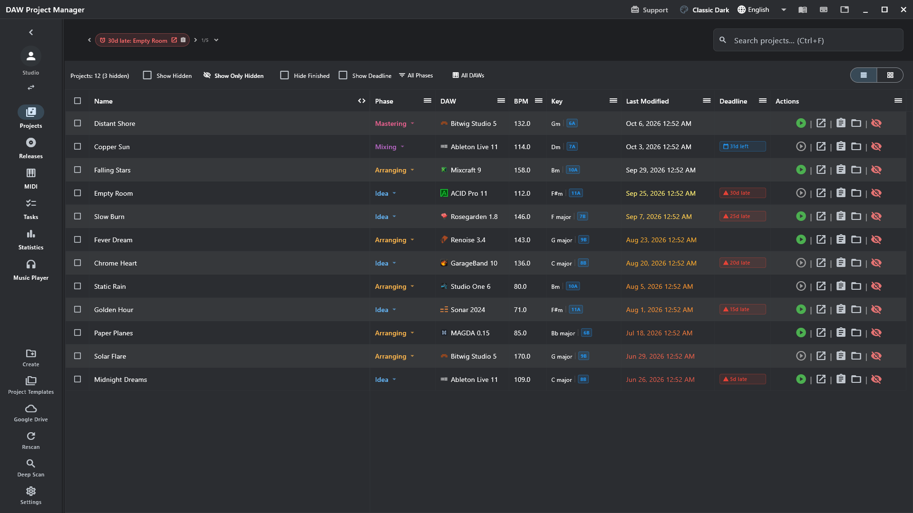
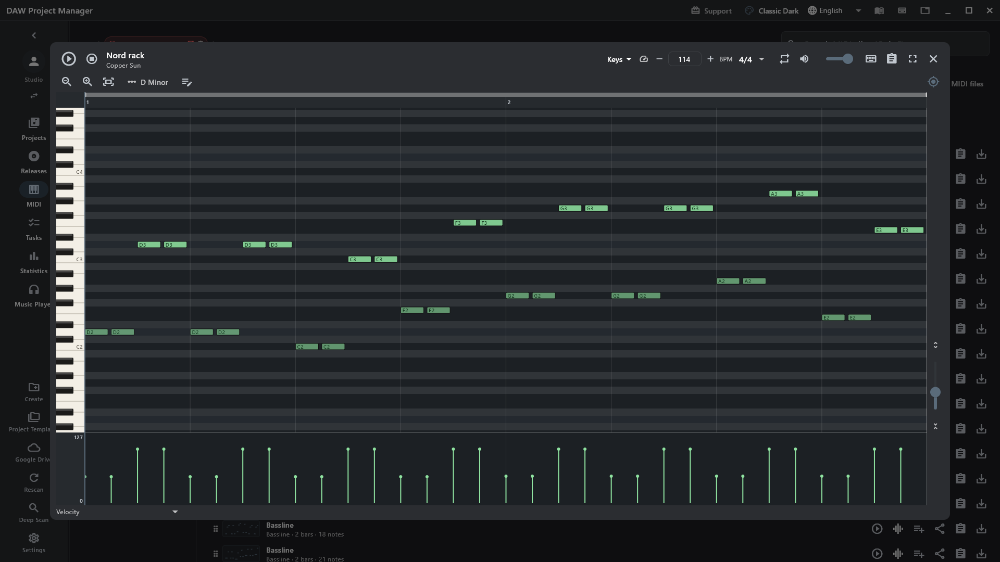
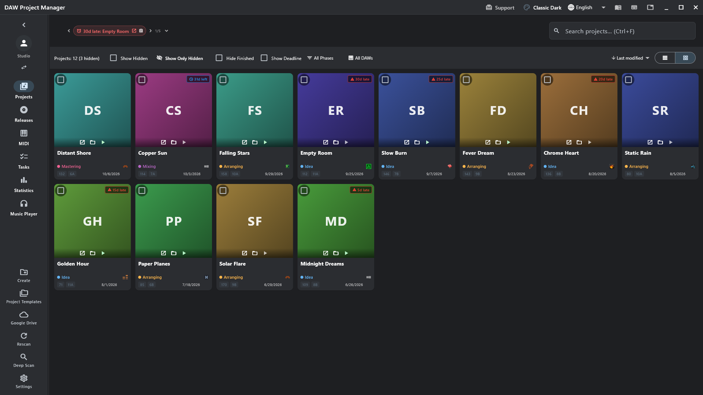
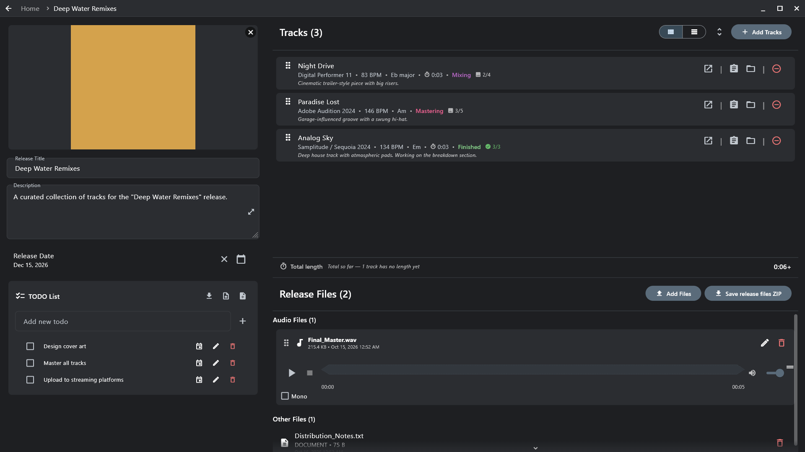
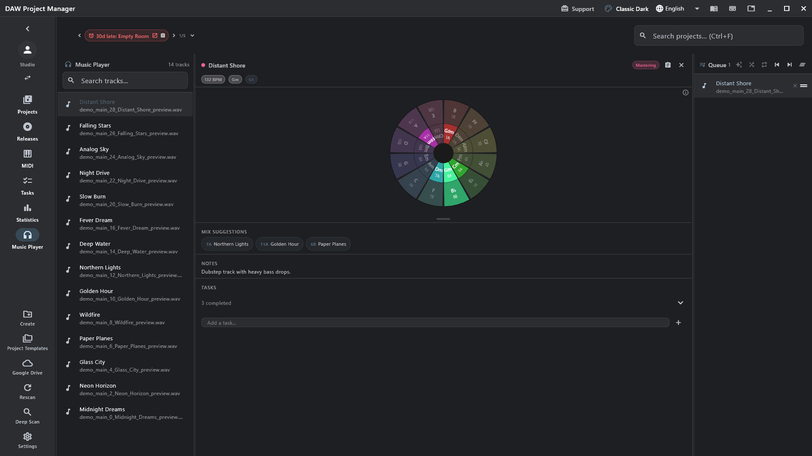
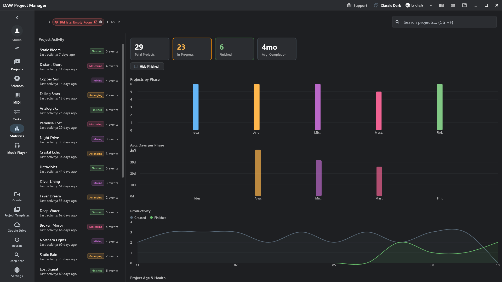
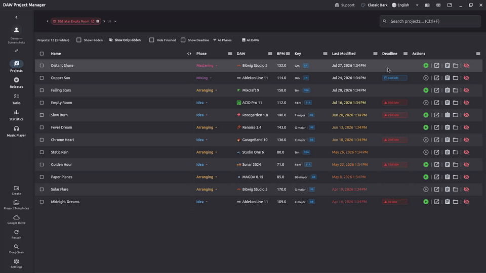

<p align="center">
  
</p>

<h1 align="center">DAW Project Manager</h1>

<p align="center">Every music project, on every drive, in every DAW — in one place.</p>

<p align="center">
  <a href="https://github.com/bandpassrecords/daw-project-manager/releases/latest"></a>
  <a href="https://github.com/bandpassrecords/daw-project-manager/actions/workflows/release.yml?query=branch%3Amain"></a>
  <a href="https://github.com/bandpassrecords/daw-project-manager/releases"></a>
  
  <a href="LICENSE"></a>
</p>

<table align="center">
  <tr>
    <td align="center" width="170">
      <a href="https://github.com/bandpassrecords/daw-project-manager/releases/latest"><br><b>Windows</b></a><br><sub>.exe · .msix</sub>
    </td>
    <td align="center" width="170">
      <a href="https://github.com/bandpassrecords/daw-project-manager/releases/latest"><br><b>macOS</b></a><br><sub>.dmg · .zip</sub>
    </td>
    <td align="center" width="170">
      <a href="https://github.com/bandpassrecords/daw-project-manager/releases/latest"><br><b>Linux</b></a><br><sub>AppImage · Flatpak · .tar.gz</sub>
    </td>
    <td align="center" width="170">
      <br><b>Android</b><br><sub>closed testing</sub>
    </td>
  </tr>
</table>

<p align="center"><a href="https://dpm.bandpassrecords.com">Website</a> · <a href="https://dpm.bandpassrecords.com/docs.html">User guide</a> · <a href="docs/development.md">Build it yourself</a></p>



## Works with your DAW

<table>
  <tr>
    <td align="center" width="96"><br><sub>Ableton Live</sub></td>
    <td align="center" width="96"><br><sub>Cubase</sub></td>
    <td align="center" width="96"><br><sub>FL Studio</sub></td>
    <td align="center" width="96"><br><sub>Logic Pro</sub></td>
    <td align="center" width="96"><br><sub>Reaper</sub></td>
    <td align="center" width="96"><br><sub>Studio One</sub></td>
    <td align="center" width="96"><br><sub>Bitwig Studio</sub></td>
  </tr>
  <tr>
    <td align="center"><br><sub>Pro Tools</sub></td>
    <td align="center"><br><sub>Nuendo</sub></td>
    <td align="center"><br><sub>LUNA</sub></td>
    <td align="center"><br><sub>Cakewalk</sub></td>
    <td align="center"><br><sub>Waveform</sub></td>
    <td align="center"><br><sub>Maschine</sub></td>
    <td align="center"><br><sub>MAGDA</sub></td>
  </tr>
  <tr>
    <td align="center"><br><sub>GarageBand</sub></td>
    <td align="center"><br><sub>Reason</sub></td>
    <td align="center"><br><sub>Ardour</sub></td>
    <td align="center"><br><sub>Renoise</sub></td>
    <td align="center"><br><sub>Mixcraft</sub></td>
    <td align="center"><br><sub>ACID Pro</sub></td>
    <td align="center"><br><sub>Samplitude</sub></td>
  </tr>
  <tr>
    <td align="center"><br><sub>Digital Performer</sub></td>
    <td align="center"><br><sub>Audition</sub></td>
    <td align="center"><br><sub>Audacity</sub></td>
    <td align="center"><br><sub>LMMS</sub></td>
    <td align="center"><br><sub>Qtractor</sub></td>
    <td align="center"><br><sub>Rosegarden</sub></td>
    <td align="center"><br><sub>Zrythm</sub></td>
  </tr>
</table>

Tempo, key, version, tracks, plug-ins and MIDI read from the project files → [what is read from each DAW](https://dpm.bandpassrecords.com/docs.html#metadata-extraction)

## What it does

<table>
  <tr>
    <td width="50%"><br><b>Every MIDI clip</b> of every project — play, edit, export.</td>
    <td width="50%"><br><b>Your library at a glance</b> — phases, deadlines, keys.</td>
  </tr>
  <tr>
    <td><br><b>Releases</b> — tracks, artwork, files, to-dos.</td>
    <td><br><b>Mix by key</b> — the player suggests what fits next.</td>
  </tr>
  <tr>
    <td><br><b>Statistics</b> — where your songs stand.</td>
    <td><br><b>Plays your mixdowns</b> — found next to each project.</td>
  </tr>
</table>

More in the [user guide](https://dpm.bandpassrecords.com/docs.html) · [MIDI clips and collections](https://dpm.bandpassrecords.com/docs.html#midi-clips)

## Contribute

```bash
git clone https://github.com/bandpassrecords/daw-project-manager.git
cd daw-project-manager
cp lib/config/oauth_config.dart.template lib/config/oauth_config.dart
flutter pub get
flutter run -d windows   # or macos, linux, an Android/iOS device
```

| | |
|---|---|
| 🛠 [Development setup](docs/development.md) | per platform, in a few minutes |
| 🧪 [Testing](docs/testing.md) | unit tests, real DAW projects, end-to-end flows |
| 🧭 [Architecture](docs/architecture.md) | where things live |
| 🚀 [Releasing](docs/releasing.md) | for maintainers |

<sub>MIT licensed · BandPass Records</sub>
