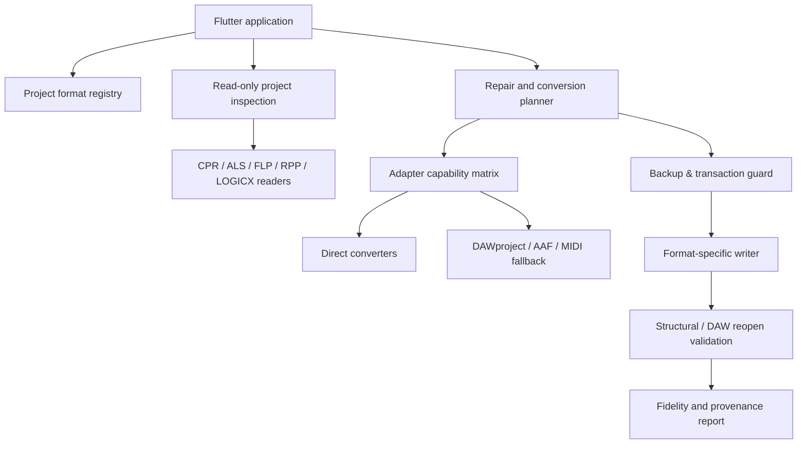

# Architecture decision record: project inspection, repair and conversion

**ADR status:** Proposed. **Host:** DAW Project Manager (Flutter). **Principle:** upstream-friendly optional features, with reusable format adapters and independent repair engines.

## Component boundaries

## Packages

- **format-registry:** magic signatures, format versions, declared adapter capabilities, evidence level and input constraints.
- **inspection-core:** immutable read-only project inventory (tracks, instances, plugins, presets, routing, media, automation) with source spans, uncertainty and stable object identity.
- **plugin-registry:** local VST2/VST3/AU/CLAP inventory. Separate static scan from sandboxed dynamic load probes.
- **conversion-planner:** directed graph of possible routes. Scoring penalizes unverified/lost musical data, especially notes, timing, plug-in state, routing and automation.
- **cpr-engine:** initially leverage CubaseTools for extraction; research record-level parsing/writing from MyDAW. A heuristic inspector MUST NOT become a writer without structural proof.
- **adapter-execution:** version-pinned subprocesses (DawVert and others) with bounded input/output, no shell interpolation, timeout and isolation; license review before packaging.
- **state-translators:** versioned mappings for plug-in UIDs, state blobs, parameter units and automation; failure returns an explicit unverified or unsupported state.
- **safety-guard:** mandatory original backup, immutable provenance, staging and validated output publication.
- **fidelity-engine:** semantic diff by element/object, unknowns, coverage matrix, reopen result and optionally rendered audio comparison.

## Model design

Two separate internal representations prevent inspection summaries from destroying information:

1. **InspectionSummary**: small, cross-DAW, read-only indexed metadata for catalog/search.
2. **SessionIR**: rich typed structure containing source identities, timeline units, events, clip ranges, tempo map, automation interpolation, track graphs, plugin identities and complete opaque chunks with offsets and provenance. Never use a metadata-only summary as conversion input.

Objects need **stable source identifiers**; do not deduplicate tracks or plugin instances by display name. Every property has a support state and evidence pointer. Paths to samples resolve relative to the source project and must remain portable or explicitly unresolved.

## Required write transaction

1. Validate input type, size and writable output directory; refuse conflicting source/target.
2. Read immutable source; calculate SHA-256.
3. Copy original into a managed backup folder with unique time + collision-safe identifier.
4. Flush backup, read it back, and verify complete length and SHA-256. Abort on any failure.
5. Construct change plan and explicit user approval. Preserve original states.
6. Write to a new staging file; validate structure, size, hashes and typed invariants.
7. Publish a **new** output file and sidecar report; never replace source.
8. Where available, reopen in the DAW and compare significant objects/audio; mark unverified otherwise.

No deletion of managed backup artifacts. Do not confuse application temporary caches with protected backups. Cross-filesystem move or non-atomic filesystem semantics must be handled conservatively.

## Parser and writer policy

- Reader tolerates unknown structures but records them with offsets and byte length.
- Writer is **disabled** for any CPR generation without lossless byte-identical round-trip and tested offset reference repair.
- Rebase all structural/object references after insertion or deletion; preserve embedded plug-in data and unrelated chunks.
- Compare source/target in a typed semantic diff, not only a checksum.
- Modern CPR version support is proven per fixture; old Cubase 5.1.1 writer results do not certify Cubase 10–15.
- Validate malicious/corrupt file handling before enabling bulk operations.

## Integration strategy

Keep optional UI screens and adapter interfaces in the MIT host. Prefer permissively licensed reusable libraries. GPL components require license/legal review and should initially be user-installed independent CLI tools with explicit consent; process separation does not by itself eliminate licensing obligations.

No existing upstream feature is presumed accepted. Changes are divided into small, reviewable PRs.
